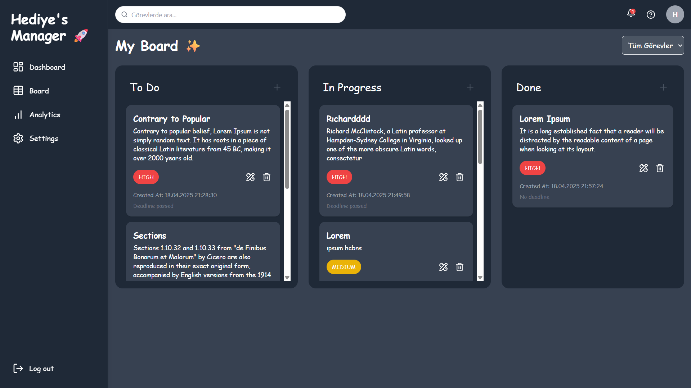
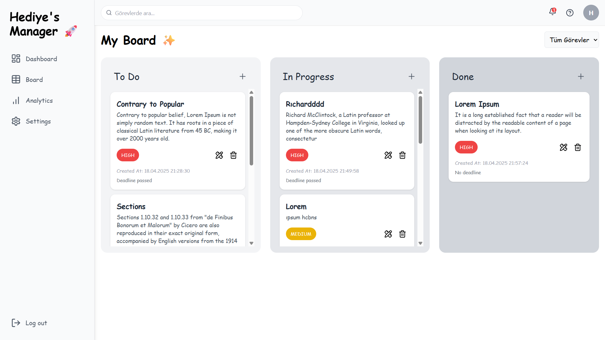
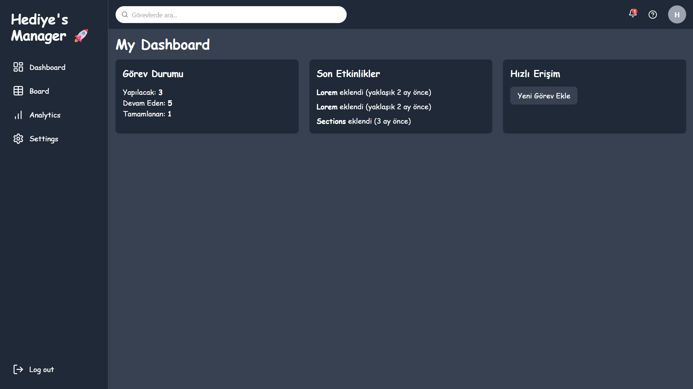
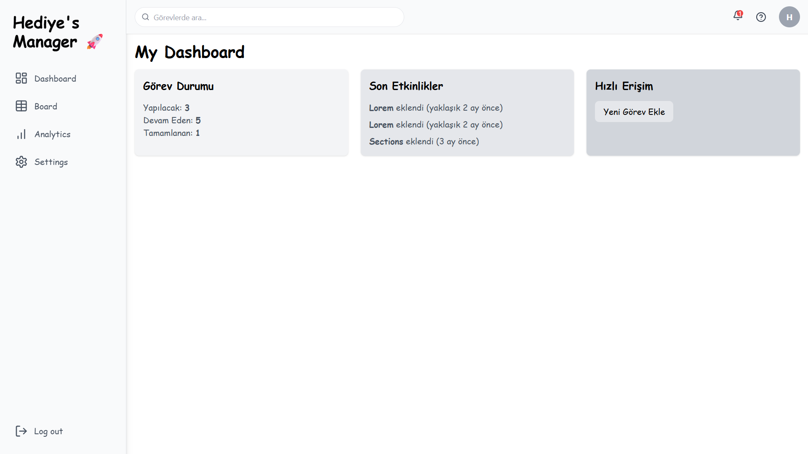
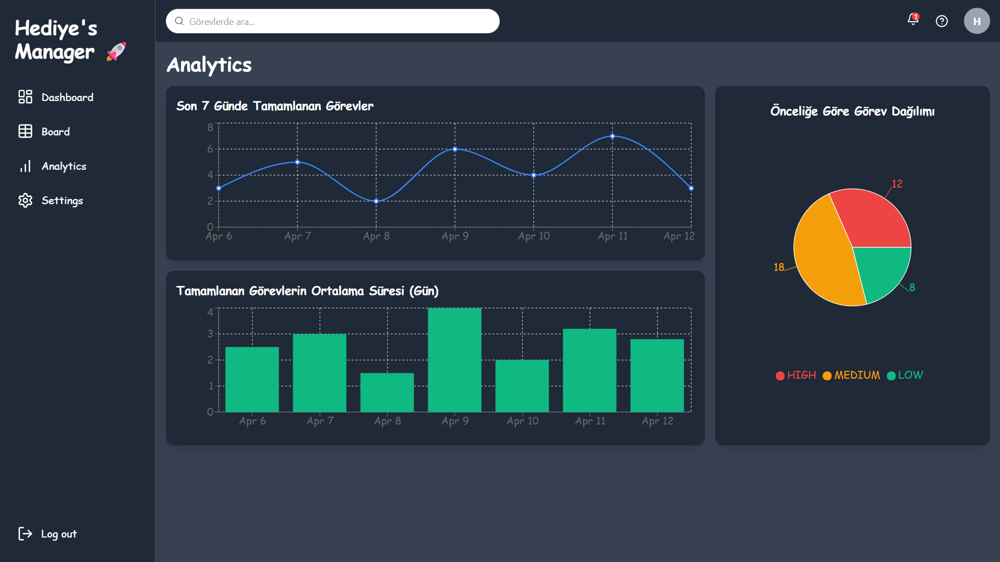
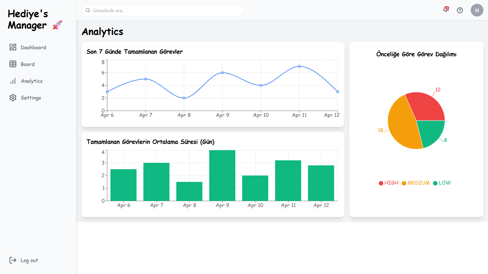

# Task Manager - Frontend

Modern ve kullanıcı dostu bir **task management** arayüzü. React, Tailwind CSS ve Vite kullanılarak geliştirilmiştir. 

---

## Özellikler

- JWT tabanlı güvenli kullanıcı girişi  
- Görev oluşturma, güncelleme, silme işlemleri  
- Görevler için son tarih ve öncelik seviyesi belirleme  
- Modal yapısı ile görev işlemlerini kolaylaştırma  
- Şimdilik masaüstü cihazlara optimize edilmiş kullanıcı deneyimi  

---

## Kullanılan Teknolojiler

- React  
- Tailwind CSS  
- Vite  
- JWT (kimlik doğrulama)  
- JavaScript (ES6+)  

---









## Başlarken

Projeyi yerel ortamda çalıştırmak için:

```bash
git clone https://github.com/hediye-ersan/taskmanager-frontend.git
cd taskmanager-frontend
npm install
npm run dev
